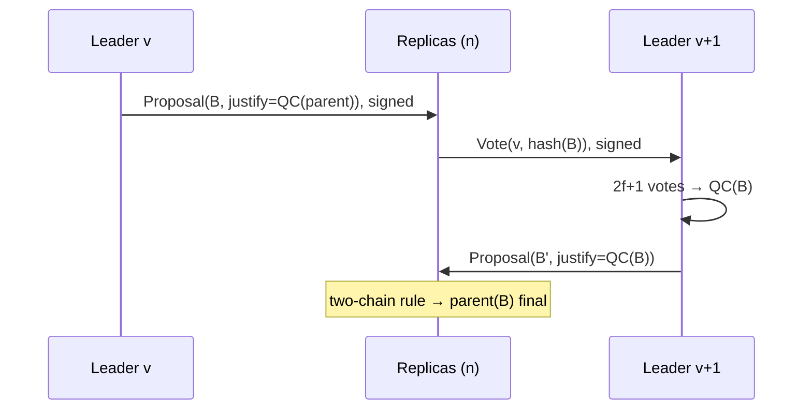
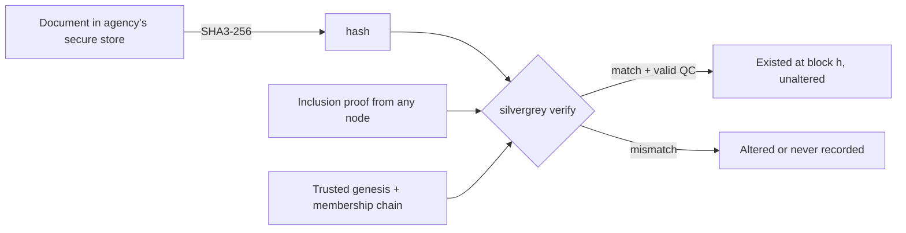

# Silver Grey Ledger: Design Specification

*None Swifter Than These.*

**Status: M4.** M5 is on hold and is not started. Nothing in this document is a performance claim except the measurements in [benchmarks.md](benchmarks.md), which record one run on the build VM. They describe that run. Every other size below is arithmetic from published parameter sizes, not a measurement. Section 11 records the owner's decisions. Section 12 is the normative encoding M0 ships. Section 13 is the normative consensus behaviour M1 ships. Section 14 is the normative storage, crash recovery, local cluster, and CLI M2 ships. Section 15 is the normative transport, mempool, API, and measured figures M3 ships. Section 16 is the normative governance behaviour M4 ships. Sections 12–15 are the record of what those milestones shipped; where they say a later milestone has not been built, section 16 supersedes that sentence.

Version 0.1, 10 Nov 2026. Public repository: https://github.com/silvergreyhound/silver-grey-ledger. Source: the *Silver Grey Ledger* concept whitepaper (Nov 2026).

---

## 1. Goals and non-goals

### Goals
- **One shared, append-only history** of critical defense events: supply-chain steps, clearance changes, and system access. Several independent organisations hold that history, and no one of them controls it.
- **Byzantine fault tolerance.** With `n = 3f + 1` nodes, the ledger stays correct (safe) with up to `f` malicious or broken nodes, and keeps making progress (live) once the network is stable.
- **Write once, never change.** An entry is final after a quorum certificate (QC) commits it. Nothing is edited or deleted. A correction is a new entry that points to the old one.
- **Minimal data.** The ledger stores identifiers, timestamps, status codes and SHA-3 hashes of documents. The documents themselves stay in each organisation's existing secure store.
- **Clear attribution.** Every entry is signed by a named, role-checked identity. Every block is signed by the leader that proposed it and certified by the nodes that voted for it.
- **Post-quantum signatures by default.** We use ML-DSA (FIPS 204) and SHA-3 (FIPS 202). SLH-DSA (FIPS 205) protects long-lived root and genesis keys.
- **Production quality from the first commit.** Every milestone ships real, tested code. Later milestones add features; nothing is rewritten.
- **A layer alongside existing systems.** Those systems connect through the API and CLI. Silver Grey Ledger replaces none of them.

### Non-goals
- No cryptocurrency, tokens, fees, mining, or open membership. It is permissioned only.
- No smart contracts or general computation. The state machine is fixed: append events and manage membership.
- No document storage and no encrypted payloads in v1 (see §8, confidentiality limits).
- No invented cryptographic primitives. We write our own consensus *implementation* of a published protocol, never our own cryptography.
- No dashboard in v1. It comes after the API is stable.
- No claim of certification (FIPS 140-3, Common Criteria, national accreditation). Those are later, separate processes.

---

## 2. Consensus

### 2.1 Choice: HotStuff-2, implemented from scratch in Go

We implement **HotStuff-2** (Malkhi and Nayak, *"HotStuff-2: Optimal Two-Phase Responsive BFT"*, IACR ePrint 2023/397). It is a refinement of **HotStuff** (Yin, Malkhi, Reiter, Gueta, Abraham, *"HotStuff: BFT Consensus with Linearity and Responsiveness"*, PODC 2019). We write the code ourselves. The algorithm is the published one, with its published safety and liveness proofs. We do not change the protocol rules. Any deviation needs a written argument and a TLA+ check (§9).

**Why this family:**

| Option | Strengths | Weaknesses for us |
|---|---|---|
| PBFT (Castro and Liskov, OSDI 1999) | Most studied. | Complex view change with O(n²) to O(n³) messages, and a fixed leader that can censor until it is replaced. |
| Tendermint-style (Buchman, Kwon, Milosevic, arXiv 1807.04938) | Simple, rotating proposer, proven in production. | Each height must wait for a timeout bound (not responsive), and votes are all-to-all gossip. |
| **HotStuff-2** | Two phases, leader rotation every view, linear view change, responsive, and a simple safety rule ("lock on the highest QC"). | Newer than PBFT, so it has fewer independent implementations. We offset this with TLA+ and simulation testing. |

Signature size matters for us (§2.4). HotStuff's star pattern sends votes to the next leader only, not to everyone. That gives O(n) signatures per view instead of O(n²), and it is the deciding argument.

### 2.2 Model and assumptions
- **Nodes:** `n = 3f + 1` validators with a known, signed membership set. Quorum `q = 2f + 1`. Recommended deployment sizes are n = 4 (f=1), 7 (f=2) or 10 (f=3), each node run by a different organisation.
- **Network:** partial synchrony (Dwork, Lynch, Stockmeyer, JACM 1988). Safety holds under any message delay. Liveness holds after an unknown Global Stabilisation Time.
- **Crypto:** ML-DSA is EUF-CMA secure and SHA3-256 is collision resistant.
- **Clocks:** consensus safety never depends on clocks. Event timestamps are *claims* by writers. Each block also carries the leader's timestamp, which validators bound to their local clock ± a configured skew window. They reject blocks outside that window, so it is a sanity check, not a trusted time source.

### 2.3 Protocol outline
- **Views and leaders:** the leader for view `v` is `members[v mod n]`, using a deterministic order from the membership set. Every view gets a new leader, so a censoring leader holds the chain for at most one view.
- **Propose:** the leader builds block `B` with the highest QC it knows (`B.justify`), signs it, and broadcasts it.
- **Vote:** a replica votes if `B` extends its locked block, or if `B.justify` is from a higher view than its lock (the HotStuff-2 rule). It sends the vote (an ML-DSA signature over `(chain_id, view, block_hash)`) to the leader of `v+1`.
- **Certify:** `2f+1` votes form `QC(B)`.
- **Commit (two-chain rule):** when `B'` carries a QC for `B`, and `B` is certified in the view directly after `B`'s parent, the parent is **final**. Finality is deterministic: no probabilistic confirmations and no forks after commit.
- **Pacemaker / view change:** a replica that sees no progress before a timeout (exponential backoff) signs `Timeout(v, highQC)` and broadcasts it. `2f+1` timeouts form a **Timeout Certificate (TC)** that moves everyone to `v+1`. This follows the TC design used in DiemBFT v4 / Jolteon (Gelashvili et al., *"Jolteon and Ditto"*, FC 2022).
- **Equivocation evidence:** two signed messages from the same node in the same view for different blocks are stored as `EquivocationProof`. Governance can then remove that node (§4).



### 2.4 Post-quantum signature size and its effects

Published sizes (FIPS 204, matching Go's `crypto/mldsa` constants):

| Scheme | Public key | Signature |
|---|---|---|
| ML-DSA-44 | 1,312 B | 2,420 B |
| **ML-DSA-65 (default)** | 1,952 B | 3,309 B |
| ML-DSA-87 | 2,592 B | 4,627 B |
| SLH-DSA-SHA2-128s / SHAKE-128s (FIPS 205) | 32 B | 7,856 B |

ML-DSA has **no signature aggregation** like BLS. A QC is therefore a signer bitmap plus `2f+1` full signatures:

| n | Quorum | QC signature bytes (ML-DSA-65) |
|---|---|---|
| 4 | 3 | ≈ 9.9 KB |
| 7 | 5 | ≈ 16.5 KB |
| 10 | 7 | ≈ 23.2 KB |
| 31 | 21 | ≈ 69.5 KB |

Each event also carries the writer's signature (≈3.3 KB). That signature is usually **10× or more the size of the event's own fields**. In practice, signatures will make up most of the storage and bandwidth.

**Mitigations (all use standard techniques):**
1. **Linear voting.** Votes go to one node, the next leader, and are never broadcast.
2. **Batching.** One QC certifies a whole block of events, so the QC cost is shared across all of them.
3. **Store each QC once.** The QC for block `h` sits only in block `h+1` (`justify`). Signer identities are a bitmap, not public keys.
4. **Sign hashes.** Signatures always cover a 32-byte SHA3-256 digest with a domain-separated FIPS 204 *context string* (`"silvergrey/v1/vote"`, `"silvergrey/v1/event"`, and so on), never large payloads.
5. **Writer signatures are one ML-DSA-65 signature per event** (decision 3). A gateway batch signature is not part of v1.
6. **ML-DSA-65 is the only signature parameter set** for events, proposals, and votes (decision 2). ML-DSA-44 is not used.
7. **Pruning** consensus-only messages (timeouts, votes) after commit. We never prune blocks or QCs.

We will measure CPU and bandwidth in milestone M3 and publish them with the method used. This document gives no figures.

---

## 3. Data model

### 3.1 Canonical encoding
- We write our own **deterministic binary encoding** (`silvergrey/codec`). It has fixed field order, big-endian fixed-width integers, length-prefixed byte strings, no optional or duplicated fields, no floats, and no maps. Every type starts with a 2-byte `type_id` and a 2-byte `version`.
- **Strict decoding:** trailing bytes, non-minimal lengths, unknown versions and oversize fields are all rejected. Encoding then decoding then encoding must give the same bytes, and the fuzz tests enforce this (§9).
- The hash of any object is `SHA3-256(domain_tag || canonical_bytes)`. Each type has its own domain tag, so a hash of one type can never pass as another.

### 3.2 Event record

| Field | Type | Notes |
|---|---|---|
| `chain_id` | 32 B | Hash of the genesis block. Prevents cross-chain replay. |
| `event_type` | u16 | e.g. `SHIPMENT_DISPATCHED`, `CLEARANCE_GRANTED`, `ACCESS_LOGIN`. The registry is set at genesis and extended by governance. |
| `subject_id` | bytes ≤ 64 | Opaque identifier (part serial, person pseudonym, system ID). Never a name. |
| `status` | u16 | New status code for this event type. |
| `prev_event` | 32 B or zero | Hash of the earlier event for the same subject. This forms a per-subject chain, and corrections point back through it. |
| `doc_hashes` | list ≤ 16 of (alg u8, 32 B) | SHA3-256 of each supporting document. |
| `claimed_time` | i64 (Unix ns, UTC) | Writer's claimed time. |
| `writer_id` | 32 B | Hash of the writer's public key. |
| `nonce` | u64 | Per-writer, strictly increasing. Prevents replay. |
| `read_policy` | u16 | Policy tag (§4.3). |
| `sig` | ML-DSA sig | Covers all the fields above, context `"silvergrey/v1/event"`. |

`event_id = SHA3-256("silvergrey/event" || canonical_bytes_without_sig)`.

### 3.3 Block

```
BlockHeader {
  chain_id, height u64, view u64,
  parent_hash 32B,            // hash chain
  justify QC,                 // certifies parent
  events_root 32B,            // Merkle root of event_ids
  state_root 32B,             // membership/role/nonce state after this block
  proposer_id 32B, proposer_time i64
}
Block { header, events[], proposer_sig }
QC { view, block_hash, signer_bitmap, sigs[] }
```

- **Hash chain:** `block_hash = SHA3-256("silvergrey/block" || header)`. Changing any past block changes every later hash and breaks the QCs.
- **Merkle tree:** we use a binary SHA3-256 tree with RFC 6962-style leaf and node prefixes (`0x00`/`0x01`), which blocks second-preimage attacks.
- **State root:** a Merkle commitment over sorted key-value state: members, roles, writer nonces and policy tags. New nodes use it for state sync (§6).

### 3.4 Proofs and the document check

An **inclusion proof** contains the event, its Merkle path to `events_root`, the block header, and the QC from the next block. A verifier needs only the trusted genesis and the membership history, so it can check offline.



The ledger proves that a hash was recorded by an authorised writer at a certain block. It does not prove that the document's *contents* are true.

---

## 4. Identity and permissions

### 4.1 Genesis
The genesis file holds `chain_id` parameters, the initial validator set (public keys, network addresses, operating organisation), the role assignments, the event-type registry, governance thresholds, and the root keys. Each founding organisation signs it with its **SLH-DSA root key**, and nodes refuse to start without the full set of founding signatures. At least two founding organisations are required. A genesis with fewer, and any later change that would leave fewer than two founding organisations with a live admin, is rejected. SLH-DSA is used here because its security rests only on hash functions, and these keys must last for decades.

### 4.2 Roles

| Role | Can do |
|---|---|
| `validator` | Take part in consensus. A validator does not get write access automatically. |
| `writer` | Submit events, limited to the `event_type`s listed in its grant. |
| `reader` | Query events, filtered by read policy. |
| `auditor` | Read all events and proofs, plus governance history. Cannot write. |
| `admin` | Propose governance actions. Cannot apply them alone. |

Each identity is a public key with a role grant, recorded on the ledger by a governance transaction.

### 4.3 Read policy
Each event carries a `read_policy` tag, such as `ALL_MEMBERS`, `ORG_ONLY`, or `AUDITORS`. The API node checks the caller's role and organisation before it returns data. **Limit:** every validator stores every event, so read policy controls the API and nothing else (§8.4).

### 4.4 Governance
- Changes to the validator set, role grants, the event registry and parameters are **governance transactions**. They need signatures from at least `G` distinct founding organisations. `G` is `ceil(2/3)` of the founding organisations. One founder cannot pass a governance transaction alone.
- A validator-set change takes effect at the inclusion height plus the fixed epoch delay `k`. The signer does not choose that height. Every honest node switches at the same block.
- Revocation removes the seat in that same batch. After the batch, `n` is still `3f+1` with `4 ≤ n ≤ 31`. A revocation that would leave an illegal `n` is rejected unless the same batch also adds or removes seats so the result is legal.
- No single admin can grant a role, add a node, or remove one.

### 4.5 Key rotation and revocation
- **Rotation:** the old key signs `Rotate(new_pk)` and the new key signs it too. Governance then confirms rotation of validator keys.
- **Revocation:** governance signs `Revoke(key_id)`. The key is removed from the bitmap at the inclusion height plus `k`. Nothing it signs after that height is accepted. Events signed before it stay in the chain. Certificates and votes from the previous epoch still verify against that epoch's validator set. The new set votes from the effect height.
- **Compromise:** when a key may have leaked, revocation can carry a "suspect since height h" flag. Events signed after `h` are then marked suspect in query results, but they are never deleted.
- **Key storage:** production keys are held in an HSM or PKCS#11 device (decision 4). An encrypted key file is allowed only on test networks. M0 does not write key files and does not talk to an HSM.

---

## 5. Networking

- **Transport:** mutually authenticated TLS 1.3 (Go `crypto/tls`). Go has enabled the **X25519MLKEM768** hybrid post-quantum key exchange by default since Go 1.24. Since Go 1.27, `crypto/tls` and `crypto/x509` also support **ML-DSA certificates and signatures**, so node certificates can be ML-DSA-65. We pin the TLS 1.3 minimum and allow only the hybrid group. Peer certificates are accepted only if they match a public key in the current on-ledger validator set, so we run no external CA trust.
- **Topology:** v1 is a full mesh between validators, which suits n ≤ about 31. Consensus messages go point-to-point as the protocol requires. Transactions spread through a mempool **gossip** that sends hash announcements first and the full body on request.
- **Message types:** `Proposal`, `Vote`, `Timeout`, `TC`, `NewView`, `TxAnnounce`, `TxRequest`, `TxBody`, `BlockRequest`, `BlockResponse`, `SnapshotChunkRequest`, `SnapshotChunk`, `Evidence`, `Ping`.
- **Framing:** each frame is `u32 length` + `type_id` + canonical body, with a hard maximum frame size per type.
- **DoS limits:** per-peer token-bucket rate limits for each message type, bounded queues that drop the oldest low-priority gossip first (never consensus messages), mempool caps per writer and in total, and signature checks only *after* cheap structural checks. Repeated invalid messages from a peer lower its score and lead to a temporary disconnect. Client API traffic runs on a separate listener with its own limits.

M3 implements this section as specified in §15. The M2 plaintext link in §14.4 is the previous milestone's record.

---

## 6. Storage

- **Block store:** append-only segment files of length-prefixed, checksummed records, plus an index from height to offset. We never update a record in place.
- **Crash safety:** a block is written and `fsync`ed (file and directory) *before* the node votes for anything that depends on it. Safety state (`locked_qc`, `last_voted_view`, `high_qc`) goes into a separate small file using write-temp → fsync → rename → fsync-dir. A node that crashes and restarts can then never vote twice in a view. On startup, recovery truncates any torn tail record after checking its checksum.
- **State:** a key-value store for current membership, roles, nonces and policies, plus indexes by `subject_id`, `event_type`, and `doc_hash`. We use **Pebble** (`github.com/cockroachdb/pebble`) to avoid writing our own LSM. The state is always rebuildable by replaying blocks, so if it is corrupted, we rebuild it.
- **Snapshots:** every K blocks, a node produces a state snapshot committed by `state_root`, in chunks with a hash for each chunk.
- **State sync:** a new or lagging node:
  1. Verifies the chain of membership changes from genesis (headers + QCs only).
  2. Downloads a snapshot from any peer and checks it against a QC-certified `state_root`.
  3. Fetches the remaining blocks.

  It trusts no single peer. **Full block history is always kept** by default, because this is an audit ledger.

M2 implements the block log, the safety file, and the Pebble state. The height index is the Pebble height key together with a scan of the log, not a separate index file. Snapshots and state sync stay M5. The formats and the crash rules are in §14.

---

## 7. API and CLI

**Client auth:** mTLS with an ML-DSA client certificate bound to an on-ledger identity. Write requests also carry the event's own signature, so the API node cannot forge entries. A malicious API node can only drop requests, and clients defend against that by submitting through several nodes.

**API** (gRPC, with a REST/JSON gateway generated from the same definitions):

| Endpoint | Purpose |
|---|---|
| `POST /v1/events` | Submit a signed event. Returns `event_id` and status `pending`. |
| `GET /v1/events/{id}` | Event plus finality status. |
| `GET /v1/events/{id}/proof` | Inclusion proof. |
| `GET /v1/subjects/{subject_id}/history` | Per-subject chain, filtered by policy. |
| `POST /v1/verify/document` | Hash plus optional proof. Returns match, block, and time. |
| `GET /v1/blocks/{height}`, `/v1/blocks/latest` | Blocks and headers. |
| `GET /v1/stream/events` | Server-streamed committed events for "real-time history". |
| `POST /v1/governance/proposals`, `/{id}/sign` | Governance flow. |
| `GET /v1/members`, `GET /v1/membership`, `/v1/status`, `/metrics` | The current member list, the certified membership history a client uses to learn the validator set, node health, and Prometheus metrics. |

**CLI** (`silvergrey`):

```
silvergrey keygen --alg ml-dsa-65|slh-dsa-shake-128s
silvergrey genesis init|sign|verify
silvergrey node start --config node.toml
silvergrey event submit --type SHIPMENT_DISPATCHED --subject PN-123 --doc file.pdf
silvergrey event get <id>        silvergrey event proof <id> > proof.bin
silvergrey verify document file.pdf [--proof proof.bin]    # works offline
silvergrey history <subject_id>
silvergrey gov propose add-validator|grant-role|revoke-key ...
silvergrey gov sign <proposal>   silvergrey gov list
silvergrey status | peers | snapshot create
```

`silvergrey event submit --doc` hashes the file on the client. The document never leaves the client.

M3 serves the event, block, member, and status methods over mTLS, both as gRPC and as JSON on the same port. Governance routes and `/metrics` are not served. The exact limits and the CLI flags are in §15.

---

## 8. Security model

### 8.1 Threats and responses

| Threat | Response | Guarantee |
|---|---|---|
| ≤ f validators compromised | BFT quorums | Safety and liveness after GST. |
| > f validators compromised (⅓ or more) | Equivocation evidence is detectable | **No safety guarantee.** Two finalised histories can be detected afterwards through conflicting QCs, but they cannot be prevented. |
| Leader censors events | Leader rotates every view, and clients resubmit via other nodes | Inclusion within a bounded number of views once an honest leader takes its turn, after GST. |
| Equivocation (double vote or propose) | Signed evidence leads to governance removal | Proof is attributable. |
| Replay (cross-chain, cross-type, duplicate) | `chain_id`, domain-separated contexts, per-writer nonces | Rejected. |
| Writer key theft | Revocation and "suspect since" marking | Forged events are attributable to the stolen key. They cannot be deleted, only flagged. |
| Compromised admin | Governance needs G organisations | A single admin can only *propose*. |
| Validator key theft | Rotation and revocation via governance | Equivalent to a compromised node until revoked. |
| Malicious API node | Client signatures, independent proofs | Cannot forge events. Can withhold or delay them. |
| Malformed input / parser bugs | Strict codec, size limits, fuzzing | Best effort. Tested, not proven. |
| Quantum adversary | ML-DSA, SLH-DSA, hybrid ML-KEM TLS | Relies on the NIST PQC security assumptions. |

### 8.2 What is guaranteed
Once a block is final, any honest node and any offline verifier with the genesis sees the same entry, from the same signer, at the same height, for as long as no more than `f` validators are faulty.

### 8.3 What is not guaranteed
- That an event is **true**. The ledger records what an authorised writer claimed.
- That `claimed_time` is accurate.
- Liveness during a long network partition.
- That data written with a key before its compromise was discovered is honest.

### 8.4 Confidentiality limits
Every validator stores every event. Read policy controls API access and does **not** enforce secrecy against validator operators. That is why v1 stores only opaque IDs, status codes and hashes. Even these can leak *patterns* (who writes how often, and when). If organisations need data hidden from other validators, they need a separate design, such as per-organisation encrypted payloads or separate ledgers. That is out of scope for v1.

Document hashes of low-entropy documents (short forms, for example) can be guessed by brute force. Writers should add a random salt to such documents before hashing, kept in the source system.

---

## 9. Testing and verification

- **Unit tests** for every package, aiming for high branch coverage in `codec`, `consensus`, `store` and `crypto` wrappers. Known-answer vectors from NIST ACVP for ML-DSA and SLH-DSA, run against whichever library we call.
- **Property-based tests** (`testing/quick` or `pgregory.net/rapid`): codec round-trip, Merkle proof soundness, and state-machine invariants (nonces strictly increase, no role escalation without quorum).
- **Deterministic simulation:** the consensus core is a pure state machine (`inputs → outputs + timers`) with no goroutines or clock of its own. A simulator drives n nodes with a seeded RNG and a simulated clock (Go `testing/synctest` where it helps). It injects packet loss, reordering, delay, partitions, clock skew and crashes. Every failure reproduces from its seed. The approach is inspired by FoundationDB simulation testing and Jepsen.
- **Byzantine fault injection:** up to f nodes, then deliberately f+1 nodes to confirm the evidence is detected, behave adversarially: equivocate, vote for conflicting blocks, withhold messages, send malformed or oversize frames, or propose invalid blocks. Invariant checked on every run: **no two honest nodes ever commit different blocks at the same height.**
- **Fuzzing:** native Go fuzzing for every decoder (codec, frames, proofs, genesis, config), with crash-free and round-trip checks. Runs in CI with a time budget, plus long runs on a schedule.
- **Crash recovery:** kill -9 at random points, plus fault-injecting filesystem wrappers for torn writes and fsync failures. Check: no double votes after restart, and the store recovers to a valid prefix.
- **Formal model:** a **TLA+ specification** of the HotStuff-2 core and pacemaker, model-checked with TLC on small n for agreement and validity. The Go simulator replays traces from the model. Any protocol change must update the model first.
- **Multi-machine tests:** real clusters on separate hosts with network fault tools (`tc netem`), run before each release.
- **Benchmarks:** codec, signing and verification, block throughput and commit latency, always published with hardware and method. No numbers are promised in advance.
- **Static checks:** `go vet`, `staticcheck`, `govulncheck`, the race detector in CI, and reproducible builds.
- **External review:** an independent security and protocol audit before any real-world (non-test) deployment.

---

## 10. Repository, dependencies, standards, milestones

### 10.1 Layout (Go module `github.com/silvergreyhound/silver-grey-ledger`)

The module path is `github.com/silvergreyhound/silver-grey-ledger`. The command is `silvergrey`. M0 creates only the packages it implements. Empty directories for later milestones are not part of the tree.

```
cmd/silvergrey/            CLI + node binary
internal/codec/       canonical binary encoding
internal/crypto/      thin wrappers: sign/verify, hash, domain tags (no primitives)
internal/types/       Event, Block, QC, TC, governance tx
internal/merkle/      tree + proofs
internal/consensus/   HotStuff-2 state machine (pure, deterministic)
internal/pacemaker/   timeouts, TCs
internal/mempool/
internal/p2p/         TLS transport, framing, gossip, rate limits
internal/store/       block segments, safety state, Pebble state/index
internal/statesync/   snapshots, sync
internal/state/       membership, roles, policy, nonce state machine
internal/api/         gRPC + REST gateway, client auth
internal/node/        wiring
pkg/verify/           standalone offline proof verifier (public API)
sim/                  deterministic simulator + Byzantine actors
spec/tla/             TLA+ model
test/e2e/             multi-process / multi-host tests
docs/                 design, threat model, ops runbook
```

### 10.2 Dependencies (minimal, pinned with `go.sum`, reviewed on every update)

| Need | Choice | Verified status (10 Nov 2026) |
|---|---|---|
| Go toolchain | **Go 1.27.x** | Go 1.27 released 19 Aug 2026. 1.27.3 is installed on the build box. |
| ML-DSA | **Go stdlib `crypto/mldsa`** | New in Go 1.27 (ML-DSA-44/65/87). Not available in the FIPS 140-3 Go module v1.0.0; available from module v1.26.0. |
| SHA-3 | Go stdlib `crypto/sha3` | In stdlib since Go 1.24. |
| TLS hybrid PQ KEX | Go stdlib `crypto/tls` (X25519MLKEM768) | Default since Go 1.24. ML-DSA TLS signatures since Go 1.27. |
| SLH-DSA | **`github.com/cloudflare/circl` v1.6.5** (`sign/slhdsa`) | Released 5 Aug 2026. All 12 FIPS 205 parameter sets. As far as we found, Go's stdlib has no SLH-DSA. |
| State KV | **`github.com/cockroachdb/pebble/v2` v2.1.7** | Pinned in `go.mod` / `go.sum`. M2 imports it. v1's latest release is older; v2.1.7 is the current module. |
| API | `google.golang.org/grpc` **v1.85.0**, `github.com/grpc-ecosystem/grpc-gateway/v2` **v2.33.0**, `google.golang.org/protobuf` **v1.36.12**, `google.golang.org/genproto/googleapis/api` **v0.0.0-20261104224025-d1e00e9f33ab** | Pinned when M3 imported them (12 Nov 2026). `googleapis/rpc` v0.0.0-20261110000943-09e21b237f2c is indirect. |
| scrypt (test-network key file) | `golang.org/x/crypto` **v0.58.0** | Direct requirement. M0–M2 selected v0.54.0. grpc v1.85.0 needs v0.58.0, so the module moved. |
| Metrics | `prometheus/client_golang` | Not imported and not served. The milestone table puts metrics in M5. Pebble v2.1.7 still requires v1.16.0 transitively. |

The circl ML-DSA package is a fallback only. We use one implementation per algorithm.

### 10.3 Coding standards
- `gofmt`, `staticcheck` and `golangci-lint` must be clean. No `unsafe`. No panics on input from the network or API.
- The consensus core has no I/O, goroutines or wall-clock time, and receives everything as inputs.
- Every wire and storage type is versioned. A format change needs a migration plan and test vectors.
- Every PR needs tests. Consensus and crypto changes need two reviewers.
- Licence: **Apache-2.0** (decision 5). Commits are signed. Releases are reproducible with SBOMs.

### 10.4 Milestones
Every milestone is production code that later milestones keep. Nothing is thrown away.

| M | Deliverable | Exit criteria |
|---|---|---|
| **M0** | Repo, CI, `codec`, `crypto` wrappers, `types`, `merkle`, `pkg/verify` | Fuzz and KAT tests pass. Codec round-trips. |
| **M1** | Consensus core + pacemaker + TLA+ model + simulator | Simulator safety invariant holds across a large seeded run budget with f Byzantine nodes. TLC passes for small n. |
| **M2** | Storage, crash safety, single-host 4-node cluster, CLI `node`/`event`/`verify` | Kill -9 and torn-write tests pass. No double votes. |
| **M3** | P2P over TLS (PQ hybrid, ML-DSA certs), mempool, DoS limits, API + mTLS | Multi-host 4- and 7-node tests under netem. First published, measured benchmarks. |
| **M4** | Governance: genesis signing (SLH-DSA), roles, read policy, membership change, rotation and revocation | Epoch switch tests. Governance-threshold tests. |
| **M5** | Snapshots, state sync, ops runbook, metrics, packaging | A new node joins from genesis and from a snapshot. Upgrade test. |
| **M6** | v1.0 release candidate: hardening, external audit, docs | Audit findings closed. Tagged release. |

The dashboard comes after M6. M5 is on hold and is not started. M4 is the current code.

---

## 11. Decisions

Decided by the owner on 10 Nov 2026. The defaults in the review draft are superseded by these.

1. **Validator count.** Design and test for n = 4 (f = 1) and n = 7 (f = 2). The code accepts every n = 3f + 1 with 4 ≤ n ≤ 31.
2. **ML-DSA parameter set.** ML-DSA-65 everywhere for now. ML-DSA-44 is not implemented.
3. **Writer signatures.** One writer signature per event.
4. **Key storage.** An HSM is required in production. An encrypted key file is allowed only for test networks.
5. **Licence.** Apache-2.0.
6. **Events per block.** The cap of 1024 is decided for v1, recorded after the M0 review. It is not waiting on a governance parameter.
7. **Module path.** `github.com/silvergreyhound/silver-grey-ledger`. The command is `silvergrey`.

Decided by the owner on 12 Nov 2026, after the M4 review. All five are closed.

8. **Founding organisations.** At least two. Genesis and any later change that would leave fewer than two founding organisations with a live admin are rejected. `G` stays `ceil(2/3)` of the founding organisations, counted from distinct organisations. One founder cannot pass governance alone.
9. **Revocation removes the seat.** The seat is removed at the effect height. It is not left as a hole until a later remove. After each epoch batch, `n` is still `3f+1` in `[4, 31]`. A batch that would not is rejected. A revocation that would leave an illegal `n` is rejected unless the same batch also adds or removes seats so the result is legal (n=7 can revoke three and finish at n=4; a revoke plus an add keeps n=4). Certificates and votes from the previous epoch verify against the previous set. The new set votes from the effect height.
10. **Clients learn the validator set from the chain.** A remote client does not pin a `--validators` file. A genesis bundle or a bootstrap address may still be required to find a node. An offline proof check, with no chain to ask, still takes an explicit validator set.
11. **Epoch model.** `spec/tla/Epoch.tla` checks membership change, rotation, revocation, and effect height = inclusion + `k`, at the bounds in §16.6. `HotStuff2.tla` stays a fixed validator set and its TLC checks are unchanged.
12. **Effect height.** A governance change takes effect at the inclusion height plus the fixed epoch delay. The signer does not choose the effective height. `suspect_since` remains the only signer-chosen height, and it cannot be after the effect.

Decided for the public tree after M4.

13. **Public name.** Silver Grey Ledger. The motto is "None Swifter Than These." The module path is `github.com/silvergreyhound/silver-grey-ledger`. The command is `silvergrey`. The public repository is https://github.com/silvergreyhound/silver-grey-ledger. M5 is on hold and is not started.

---

## 12. M0 encoding

This section is normative for the bytes M0 writes. A later milestone that changes them bumps `version`.

### 12.1 Lengths

Schema integers are fixed-width and big-endian. `int64` is two's complement in 8 bytes. Counts and byte-string lengths use the X.690 definite form, in the shortest width: one byte for 0..127, otherwise `0x80|width` plus the minimal big-endian value with no leading zero. Indefinite length (`0x80`), a long form of a short value, a leading zero, and a width above 4 are rejected. A value is accepted only when decoding it and encoding it again yields the same bytes. Trailing bytes, an unknown version, and an unexpected type id are rejected.

### 12.2 Type identifiers and version

Every versioned value starts with `type_id` (`uint16`) and `version` (`uint16` = 1).

| Type | id |
|---|---|
| Event | 1 |
| Block header | 2 |
| QC | 3 |
| Block | 4 |
| Inclusion proof | 5 |
| Validator set | 6 |
| Public key | 7 |
| Vote | 8 |
| Timeout | 9 |
| Timeout certificate | 10 |
| Proposal | 11 |
| Equivocation | 12 |
| Genesis | 13 |

Ids 1–7 are the M0 values. Ids 8–13 are defined in §13. An M0 decoder rejects them.

### 12.3 Hashes, domains, and signature contexts

Object hashes are `SHA3-256(domain || bytes)`. Document hashes are raw `SHA3-256` of the file, with no domain tag, so a standalone hash of the file matches the digest stored on the event.

| Name | Bytes |
|---|---|
| `silvergrey/event` | Canonical event body, signature excluded. This digest is `event_id`. |
| `silvergrey/block` | Canonical block header. This digest is `block_hash`. |
| `silvergrey/vote` | `chain_id \|\| view` as uint64 big-endian `\|\| block_hash`. |
| `silvergrey/key` | Algorithm byte `\|\|` raw public key. This digest is `writer_id` and `proposer_id`. |
| `silvergrey/timeout`, `silvergrey/genesis` | Reserved in M0. M1 defines the preimages in §13. |
| `silvergrey/governance` | Reserved. No signed preimage. |

Algorithm byte 1 is ML-DSA-65. Algorithm byte 2 is SLH-DSA-SHAKE-128s. A public key on the wire is the type header, the algorithm byte, and the raw key at its published length (ML-DSA-65 public key 1952 bytes, SLH-DSA-SHAKE-128s public key 32 bytes). A non-canonical encoding from the implementing library is rejected.

ML-DSA-65 signatures cover the 32-byte digest, with the FIPS 204 context string:

| Context | What it signs |
|---|---|
| `silvergrey/v1/event` | `event_id` |
| `silvergrey/v1/proposal` | `block_hash` |
| `silvergrey/v1/vote` | the vote digest |

`silvergrey/v1/timeout` and `silvergrey/v1/genesis` are accepted from M1 (§13). `silvergrey/v1/governance` is still reserved and is not accepted by the production signer. An empty context is rejected there too. Production signatures are hedged. The deterministic signer exists for known-answer tests.

The event signature is one ML-DSA-65 signature (3309 bytes) appended to the body. It is not length-prefixed. Changing it does not change `event_id`. Validators and vote keys are ML-DSA-65. SLH-DSA-SHAKE-128s is wrapped for long-lived root and genesis keys; M0 does not use it on votes.

### 12.4 Event, header, QC, and proof

Event body, in order: type header, `chain_id`, `event_type` (`uint16`, zero rejected), `subject` (1..64 bytes), `status` (`uint16`), `prev_event`, document-hash count then each hash as algorithm byte `1` plus 32 bytes (at most 16), `claimed_time` (`int64`), `writer_id`, `nonce` (`uint64`), `read_policy` (`uint16`, zero rejected). Named values in v1: event types 1 shipment dispatched, 2 clearance granted, 3 access login; read policies 1 all members, 2 org only, 3 auditors. Other non-zero values decode. The registry that gives them meaning arrives with governance.

A QC is `view`, `block_hash`, `signer_bitmap` (`uint32`), then a count and one ML-DSA-65 signature per set bit, in ascending bit order. Bits 0..30 name validators. Bit 31 is rejected. The popcount equals the signature count. The empty QC is the only absent certificate: view 0, a zero hash, bitmap 0, and a zero count. A partly empty certificate is rejected. `Quorum(n)` is `2f+1` for `n = 3f+1` with `4 ≤ n ≤ 31`, and rejects every other n. Explicitly, n = 4 needs 3 signatures and n = 7 needs 5.

A genesis header (height 0) has a zero parent hash and an empty justify QC. A later header has `justify.block_hash` equal to `parent_hash` and `view` strictly above `justify.view`. A block is the header, a count, the raw event encodings, and the proposer's ML-DSA-65 signature over `block_hash`. `events_root` is the Merkle root of the event ids. `state_root` is carried and not interpreted in M0.

An inclusion proof carries the event, its index, the leaf count, the sibling hashes, the header, and the commit QC. Verification checks the writer signature, the chain id, the header link, the Merkle path, and that the commit QC is non-empty, names this header's hash and view, and verifies under the caller-supplied validator set. That establishes that a quorum certified the block. It does not establish HotStuff-2 two-chain finality. The caller supplies the validator set in bitmap order and the writer key. Membership history is a later milestone.

### 12.5 Merkle tree

The tree is RFC 6962 with SHA3-256. A leaf is `SHA3-256(0x00 || event_id)`. An internal node is `SHA3-256(0x01 || left || right)`. The split point is the largest power of two strictly less than the leaf count. The empty tree is `SHA3-256()` of no input. Sibling hashes run from the leaf toward the root. A proof that does not consume exactly those siblings is rejected. A block holds at most 1024 events, which is also the largest tree. That cap is decided for v1 (decision 6). Changing it changes what a decoder accepts.

### 12.6 Cryptography and tests

ML-DSA-65 uses Go 1.27 `crypto/mldsa`. SLH-DSA-SHAKE-128s uses `github.com/cloudflare/circl` v1.6.5 `sign/slhdsa`. SHA3-256 uses `crypto/sha3`. No primitive is implemented in this repository. The FIPS 140-3 Go cryptographic module v1.0.0 disables `crypto/mldsa`. A production build must not use that module. The algorithm is available from Go cryptographic module v1.26.0 and in Go 1.27 by default.

ML-DSA known-answer tests use a subset of the Wycheproof vectors exercised by Go 1.27 (`github.com/c2sp/wycheproof`, commit `ee7b4f7e6119`): three ML-DSA-65 deterministic seed signatures (no context, empty context, and the context `Context`) and the invalid-verify cases for a context that is too long, a short signature, a long signature, a flipped `c̃` byte, a flipped final byte, a repeated hint, and a short public key. SLH-DSA known-answer tests use one NIST ACVP case each, taken from circl's ACVP testdata, for SHAKE-128s key generation, deterministic external-pure signing, and verification of one valid and one invalid signature. SHA3-256 is checked against the FIPS 202 empty, `abc`, and long-message vectors.

### 12.7 What M0 does not build

Networking and the API were not in the M0 tree. They are §15. An HSM driver is still not in this tree. Decision 4 applies to the test-network key file in §14: that file is forbidden in production. Tests may still export an ML-DSA seed (32 bytes) or the circl SLH-DSA private encoding (64 bytes). That export is not the key file format. Consensus arrived in M1 (§13). Storage arrived in M2 (§14). This section is the M0 codec record and is not rewritten as if those later types had shipped then.

M0 depended on circl v1.6.5, which brought `golang.org/x/crypto` v0.54.0 and `golang.org/x/sys` v0.47.0. M1 added no dependencies. The current module requires `golang.org/x/crypto` v0.58.0 (§15).

---

## 13. M1 consensus

This section is normative for the consensus core, the pacemaker, the new wire types, the simulator, and the TLA+ model. It implements §2.3. The paper (ePrint 2023/397) is the algorithm family. Where the paper's presentation is a single-shot two-phase vote in one view, this implementation is the pipelined rule in §2.3. Where the paper uses a RareSync epoch pacemaker, this implementation uses Jolteon timeout certificates, which §2.3 names explicitly.

### 13.1 Replica

`internal/consensus.Replica` is a pure state machine. One call is `Start` or `Step`. The caller supplies the clock sample (`Now`), the store, and the network. The replica has no goroutines, no disk calls, and no sockets. `Store` is the persistence boundary: M1 ships `MemoryStore` only. A later milestone can replace it without changing the replica. The snapshot keeps the chain id, the view, the lock certificate and the block it certifies, the commit height and hash, the votes and proposals this replica already signed, the views it already timed out, and the pacemaker failure count. Vote bags, proposal bags, and equivocation proofs are process-local. Losing them delays a certificate; it does not let a restarted replica sign a second vote or a second timeout for a view it already signed.

The leader of view `v` is `members[v mod n]`, index 0 of the validator set. View 0 is genesis and is signed by validator 0. The first consensus view is 1, led by validator 1.

### 13.2 Genesis certificate

A height-0 header must carry the empty QC (§12.4), and a later header must have `justify.block_hash` equal to its parent hash. The empty QC's hash is zero, so it cannot justify the first real block. M1 therefore builds a second certificate: a view-0 quorum certificate over the genesis block hash, signed by every validator with the vote context. Replicas lock on that certificate and extend it. The genesis block itself still carries the empty QC. This is required by the M0 header rule. The header rule is unchanged.

`chain_id` is `SHA3-256("silvergrey/genesis" || canonical genesis body)`. The body is the genesis header, the `created` time, and the canonical validator set. It does not contain `chain_id`. Every validator signs `chain_id` with context `silvergrey/v1/genesis`. M1 uses ML-DSA-65 for those signatures because decision 2 says ML-DSA-65 everywhere for now. SLH-DSA founding signatures remain M4, which is where the milestone table puts genesis signing.

### 13.3 Vote, lock, and commit

A replica adopts the proposal's justify certificate before it applies the vote rule, provided the certificate verifies and the parent block is stored. It votes when the block extends the locked block, or when `justify.view` is higher than the lock. It sends that vote only to the leader of `v+1`. If it is itself that leader, it counts the vote locally. The first valid vote per signer per view is the one that counts. A second vote for a different hash is equivocation and is not counted. An honest replica signs at most one vote per view, and `Load` restores that record.

The lock is the highest verified certificate whose block is stored. A second certificate of the same view and a different hash does not replace it.

Commit is the two-chain rule, including ancestors. When a certificate for block `B` is adopted and `B.view = parent(B).view + 1`, `parent(B)` is directly final. Finality of a block includes every ancestor back to the current commit, which is the paper's indirect commit and is what "finality implies the ancestors" requires: a timeout between two blocks must not make the earlier certified block uncommittable forever. The walk has to meet the current commit hash. If it does not, the replica commits nothing. A gap (`B.view` is not the parent's view plus one) does not directly commit the parent.

A block is voted for and stored only when `state_root` equals the placeholder in §13.7. A proposal outside the caller's skew is not stored and is not voted for. The skew check is a sanity check. Safety does not read the clock. The signature is still evidence if the same leader has another proposal for that view.

### 13.4 Pacemaker

On a timeout the replica signs one `Timeout(v, highQC)` and broadcasts it. A second call in the same view does not sign again. A repeat of the same high certificate is a duplicate. A different high certificate from the same signer in the same view is timeout equivocation. `2f+1` timeouts form a TC and the replica enters view `v+1`. A QC of view `v-1` is preferred: the next proposal is then consecutive and carries the empty TC. Otherwise the proposal carries the TC for view `v-1`, and its justify certificate must be at least as high as every real high certificate in that TC. An empty high certificate ranks below every real one, including the view-0 genesis certificate. Two real certificates of the same view and different hashes make `HighestQC` fail, and the TC is rejected.

The timer starts at `Base`. A view entered because of a TC doubles it, up to `Cap`, with at most 16 doublings. A view entered because of a QC resets it to `Base`. The caller enforces the timer. The replica only reports the view and the interval.

### 13.5 Wire

Version stays 1. The new type ids are vote 8, timeout 9, timeout certificate 10, proposal 11, equivocation 12, genesis 13.

A vote is the header, `chain_id`, `view`, `block_hash`, `signer`, and one ML-DSA-65 signature over `VoteDigest` with context `silvergrey/v1/vote`. `VoteDigest` is unchanged from M0. The signer index is not inside the digest. View 0 is allowed, because that is how the genesis certificate is signed. The signer must be below 31.

A timeout is the header, `chain_id`, `view`, `signer`, the high QC, and one ML-DSA-65 signature over `SHA3-256("silvergrey/timeout" || that body)` with context `silvergrey/v1/timeout`. View 0 is rejected. A non-empty high QC is verified with the timeout.

A timeout certificate is the header, `view`, a count, and the raw timeouts in strictly increasing signer order. The empty certificate is view 0 and zero timeouts, and it is the only empty one. A proposal whose view is `justify.view + 1` carries that empty certificate. Any other proposal carries a real TC for `view - 1`.

A proposal is the header, the raw block, and the raw timeout certificate. Both are self-delimiting, so neither is length-prefixed again.

An equivocation proof is the header, a kind byte (vote 1, proposal 2, timeout 3), and two length-prefixed canonical messages. The messages must differ, share a signer, a view, and a chain, and both verify. Each side is at most 1 MiB.

A genesis record is the signing body (header, `created`, canonical validator set) followed by a count and one ML-DSA-65 signature per validator. `n` must be `3f+1` with `4 ≤ n ≤ 31`.

### 13.6 What the core refuses

Malformed messages set `Output.Dropped` and return a nil error. The replica keeps running. `ErrState` and `ErrStore` are for a caller bug or a store failure. A block whose parent is missing is dropped. Retransmission and block sync are M5, so a permanently lost block can stall one replica. The safety runs of the simulator are allowed to do that. The liveness runs are not.

Events queued with `Submit` must carry this chain id and must marshal. The core does not check the writer signature: the writer key is not a member of the validator set. Writer verification stays with the API. The queue holds at most 1024 events.

### 13.7 Placeholder state root

There is no key-value Merkle state in M1. `state_root` is a link honest replicas recompute, so a leader cannot put an arbitrary digest in a block that gets a vote:

- Genesis: `SHA3-256("silvergrey/genesis" || canonical validator set)`.
- Later blocks: `SHA3-256("silvergrey/genesis" || parent_state_root || events_root || height` as uint64 big-endian`)`.

The domain is the genesis domain because M1 has no state domain. The suffixes differ from the chain-id preimage, so substituting one for the other is a SHA3-256 collision. M4 replaces this formula when the state machine exists. Validators already reject a block whose root does not match, so the replacement has to be a new version or an explicit migration.

### 13.8 Simulator

`sim` drives `n` replicas from one seed (`math/rand/v2` PCG). Delay is at least one tick, so a step cannot enqueue work for the same tick. Before the stabilisation tick the delay is uniform up to `MaxDelay`, and a safety run may drop a message. A partition holds cross-cut messages and flushes them when it ends. Liveness runs end the partition at the stabilisation tick and do not drop. After that tick the delay is one and nothing is lost. Byzantine behaviour continues.

`f = (n-1)/3` replicas are faulty. Their indexes start at `seed mod n`. Each has one mode, taken from the seed: equivocate (a second proposal with the proposer time shifted by one, plus an extra vote for a dummy hash), withhold outbound messages, flip the last byte of a copied signature, or replay an older message. The injector copies before it mutates, and it records votes from `Step` before it adds anything. The invariant is: no two replicas commit different hashes at the same height, commit heights are a chain prefix, and no honest replica emits two votes in one view. Liveness: every honest replica's commit height at the end is greater than the height recorded at the stabilisation tick, before that tick's messages are delivered.

The default `go test` campaign is the short one, unchanged since M1: safety seeds 1–6 at n=4 and 101–103 at n=7, liveness seeds 201–204 at n=4 and 301–302 at n=7. `testing.Short` uses seed 1 only. M1's large budget was safety 1–40 and 1001–1020, liveness 2001–2016 and 3001–3008 (84 runs). M2 enlarged it. The current ranges are in §14.9.

ML-DSA signatures are hedged from the process DRBG. The delivery schedule is a function of the seed. The signature bytes are not. The protocol does not branch on those bytes. `testing/synctest` is not used: the core has no goroutines, and the simulator's clock is the tick counter.

### 13.9 TLA+

`spec/tla/HotStuff2.tla` is a safety model, checked with TLC (`scripts/tlc.sh`, TLA+ tools v1.7.4, jar SHA-256 `936a262061c914694dfd669a543be24573c45d5aa0ff20a8b96b23d01e050e88`). The pacemaker is not in the model. The adversary may propose two blocks per view on any certified parent, which is stronger than "the proposal must extend the highest certificate in the TC". Each Byzantine identity contributes one vote to every proposal. Quorum-certificate delivery is a separate action. The invariants are agreement (commit sequences are prefixes), the parent chain, validity (a committed id is certified), and one honest vote per view.

Checked bounds, TLC 2.19, 2 workers, no violation:

| Config | Bound | Distinct states | Depth | Time |
|---|---|---|---|---|
| `MC4.cfg`, n=4, f=1, Byzantine `{0}` | 2 views, 4 blocks | 354,845 | 15 | 11s |
| `MC7.cfg`, n=7, f=2, Byzantine `{0,1}` | 2 views, 2 blocks | 1,874,491 | 20 | 77s |

A third block at n=7 was still growing past 18 million distinct states after several minutes, so that bound is not the CI check. TLC does not prove liveness. Liveness is the simulator.

Section 9 says the simulator replays TLC traces. M1 does not import those traces. A TLC state is not a Go message schedule, and dumping the state graph is not a useful test. The Go tests drive the happy path and the timeout path directly. A TLC counterexample is the artifact if a future run fails. That is the deviation, and it is deliberate.

### 13.10 What M1 does not build

M1 has no TLS, no mempool policy, no governance, and no state-sync snapshots. Disk durability is M2 (§14). TLS, the mempool, and the API are M3 (§15). `pkg/verify` still means "a quorum certified this block", not two-chain finality. Equivocation proofs are built and checked. Nothing removes a validator yet.

---

## 14. M2 storage, local cluster, and CLI

This section is normative for the crash-safe store, the single-host cluster, the test-network key file, and the `node` / `event` commands. The replica's rules are unchanged from §13. `PutBlock` runs before a vote is signed, and `PutSnapshot` runs before `Step` or `Start` returns, so a store that fsyncs before returning is the durability boundary.

### 14.1 Files

A node's data directory holds three things.

`blocks.log` is append-only. A record is `ABL1`, a big-endian uint32 length, the canonical block, and CRC-32/IEEE of the payload. A record longer than 32 MiB is not a record. On open, the first record that is short, badly checksummed, or not a block ends the trusted prefix, and the file is truncated there and fsynced. `PutBlock` builds the record, writes it, fsyncs the file, fsyncs the directory, and only then remembers the offset. A duplicate hash is a success and does not append. An injected sync failure leaves the index unchanged so a retry writes at the same offset.

`safety.bin` is the consensus `Snapshot`: chain id, view, lock hash, commit height and hash, failure count, the votes and proposals already signed (maps sorted by view), the views already timed out (sorted), and the lock QC. The file is `ASF1`, version 1, that body, and CRC-32/IEEE of everything before the CRC. Replacement is write `safety.next`, fsync, close, rename over `safety.bin`, fsync the directory. `safety.next` is never read as truth. Open deletes it. A `safety.bin` that does not checksum fails the open. The store does not invent an empty vote history. A crash before the rename keeps the previous snapshot, which is the one the process was allowed to act on.

`state/` is a Pebble database of derived indexes. It is not a source of truth and it is not a state-sync snapshot. If its recorded commit does not match the safety file, the directory is removed and the committed chain is replayed from the log. If a safety file was never published, leftover state is removed: the state batch is written before the snapshot rename, and a crash in between must not look like a vote. Parent links are rebuilt from the log on open so a proof can find the child that carries the certificate.

### 14.2 Votes after a crash

A block is durable before the replica signs a vote for it, because `PutBlock` returns only after the fsync. The vote, the proposal, and the timeout are durable when `PutSnapshot` returns, which is before `Step` returns them to the caller. A store error returns from `Step` with an empty output, so the caller does not send the signature. After a restart:

- a view present in `Voted` or `Proposed` is not signed again
- a view present in the timeout list is not timed out again
- a view missing from that list may be timed out once, which is the first durable timeout

`Load` is what restores those sets. `Start` is only for a directory that has no safety file.

### 14.3 Pebble

The module is `github.com/cockroachdb/pebble/v2` v2.1.7. Writes that must survive a crash use `pebble.Sync`. The keys are: `H` plus height, `E` plus event id, `S` plus subject, `Y` plus event type, `D` plus document hash, `N` plus writer id holding the maximum committed nonce, `V` for the canonical validator set, `M` for the commit height and hash, and `C` plus parent hash plus child hash. A committed nonce that is not strictly increasing is still stored as the max. The node rejects a submit whose nonce is 0 or not greater than that max and not greater than a nonce already queued in this process. The consensus core still does not check writer signatures (§13.6). The node checks the writer signature, the chain id, and the nonce before `Submit`.

Roles and read policies are not enforced. They remain M4. The validator set is stored so a later open can see that it changed. Membership changes are not applied.

Pebble v2.1.7 requires `github.com/prometheus/client_golang` v1.16.0 and a few other modules. They are indirect in `go.mod`. This tree does not import them and does not open a metrics port. gRPC is not a dependency.

### 14.4 Cluster

Four validators on one host, each in its own process (the CLI test) or its own goroutine (the package test). They speak plaintext TCP to `127.0.0.1`. A frame is a big-endian uint32 length, a kind byte, and a body, with a maximum of 8 MiB. Kinds are proposal, vote, timeout, timeout certificate, equivocation, a sync request, a sync block, a sync end, and the client operations status, submit, proof, and get. This paragraph is the M2 record. M3 replaces the link with the transport in §15.

The node that accepts a client submit verifies the event and queues it on its own replica. It does not relay the event. Relaying would put the same event in several queues, and more than one leader could commit it. Mempool gossip, with a single inclusion, is M3. A client that wants the event in the next block submits it to the node that will lead.

A restarted node can be behind by blocks the others committed while it was down. There is no state-sync snapshot. The node asks each peer for committed blocks above its commit height, plus any stored child of the commit tip, at most 256 blocks. It checks the proposer signature and the justify certificate before `PutBlock`. A proposal, timeout, or timeout certificate whose parent or high certificate is not stored yet is held and retried after those blocks arrive. That is a parent fetch so a restarted replica can vote. It is not the M5 snapshot protocol.

The client listener is separate from the consensus listener. One goroutine owns the replica. Peer reads only enqueue. A write to a peer has a 5 second deadline so one stuck socket cannot hold the replica.

Timer intervals from the replica are milliseconds. The defaults are a 500 ms base, a 4000 ms cap, and a 120000 ms skew. `ProposerTime` is Unix milliseconds.

### 14.5 Key file

`internal/keyfile` is the test-network format from decision 4. It is forbidden in production. The binary prints that on `keygen` and on `node start`. There is no HSM driver.

The file begins with the line `silvergrey-test-key-v1`, then version 1, the algorithm byte, scrypt `N`, `r`, `p` as uint32, a 16 byte salt, a 12 byte AES-256-GCM nonce, and the ciphertext. The only accepted parameters are `N = 32768`, `r = 8`, `p = 1`. Any other `N` is rejected before scrypt runs, so a file cannot ask for a multi-gigabyte derivation. The passphrase is 8 to 1024 bytes. It is not written into the config. The plaintext is the ML-DSA-65 seed (32 bytes) or the circl SLH-DSA private encoding (64 bytes). `node genesis` accepts only ML-DSA-65, matching §13.2. An SLH key can be written for a later milestone and is not a founding key here.

### 14.6 Config

The sample in §7 shows `node.toml`. M2 does not take a TOML dependency. The file is line-oriented: `key value`, `#` comments, and an unknown key is an error. The fields are `datadir`, `listen`, `client`, `peers` (comma-separated, index order, including this node), `index`, `genesis`, `keyfile`, and optional `base_timeout`, `max_timeout`, and `skew`. `silvergrey node init` writes `node.conf`. `silvergrey node start --dir` reads it. The passphrase comes from `--passphrase-file`.

### 14.7 CLI

`silvergrey hash` and `silvergrey verify document` are unchanged and stay offline. `verify` still means a quorum certified the block, not two-chain finality.

`silvergrey keygen` writes the key file and the canonical public key. `silvergrey node genesis` builds the genesis record, the height-0 block, and the view-0 certificate, and writes the validator set beside them. `silvergrey node init` writes the config. `silvergrey node start` runs the process until SIGINT or SIGTERM. `silvergrey event submit` hashes the document locally, signs one event, and submits it. `silvergrey event proof` writes the inclusion proof bytes from the node's stored blocks. `silvergrey event get` prints the committed height, subject, type, and nonce. The proof's commit QC is the justify certificate of the child block, which is the certificate of this block, matching §12.4.

### 14.8 Crash tests

The store tests inject a torn block tail, a truncated file, a sync that returns an error, a safety rename that does not happen, and a safety file whose checksum fails. The torn tail is truncated to the last good record. A failed rename keeps the previous snapshot. A corrupt `safety.bin` refuses to open.

`TestKillMidBlock` and `TestKillMidVote` start a child test process and stop it with `SIGKILL` (not `os.Exit`) during a block append and during the safety write of a timeout that follows a durable vote. The parent reopens the directory. The torn block is gone and a later block can be appended. The durable vote is still recorded, a replay does not emit another vote or proposal, and a second timeout step does not emit another timeout. `TestRestartDoesNotDoubleSign` is the same assertion without the signal, using a torn safety write. `TestTornBlockDoesNotPublishVote` checks that a failed block write does not publish a snapshot.

The CLI test kills a live node with `SIGKILL` after one event has a proof, starts it again on the same directory, submits a second event, and checks that event's proof from the restarted node with `silvergrey verify`.

### 14.9 Simulator budget

The short campaign in `go test` is unchanged, so CI stays the M1 size. `scripts/sim-budget.sh` sets `SILVERGREY_SIM_BUDGET=large`:

| Campaign | n | Seeds | Runs |
|---|---|---|---|
| Safety | 4 | 1–120 | 120 |
| Safety | 7 | 1001–1060 | 60 |
| Liveness | 4 | 2001–2048 | 48 |
| Liveness | 7 | 3001–3024 | 24 |

That is 252 runs. The script's timeout is 60 minutes. It is not a CI job. The invariants are the ones in §13.8.

### 14.10 Deviations

This list is the M2 record. §15 supersedes the transport and the mempool.

- The host link is plaintext TCP. The frame is the same length-prefix idea as §5, with a smaller set of kinds. M3 replaces it (§15).
- The config file is line-oriented rather than TOML, so M2 does not add a parser module.
- Client events are not gossiped. Mempool gossip is M3. A parent-block fetch exists only so a restarted process can see blocks it missed. State-sync snapshots stay M5.
- Prometheus appears in `go.sum` because Pebble requires it. Nothing imports it.
- `state_root` is still the §13.7 placeholder. SLH-DSA founding signatures are still M4.
- A torn `safety.bin` fails closed. It is not replaced with an empty snapshot.
- A fully written `safety.next` that was not renamed is deleted. The previous snapshot stands. A signature that never reached that file may be produced once after restart. It was not sent.

### 14.11 What M2 does not build

M2 does not build gRPC, REST, a Prometheus endpoint, an HSM, post-quantum TLS, mempool relay, governance, or a state-sync snapshot. gRPC, JSON, post-quantum TLS, and mempool relay arrive in §15. Prometheus, the HSM, governance, and snapshots stay later milestones. `MemoryStore` remains the store behind unit tests and the simulator.

---

## 15. M3 transport, mempool, and API

M3 replaces the plaintext TCP link. The replica stays a pure state machine. The node owns sockets, the mempool, and the API, and it calls the replica in the same order as M2: a block is durable before a vote, and the safety file is durable before `Step` or `Start` returns. Vote bags, proposal bags, evidence, relayed timeout certificates, and the event queue are still process-local. A restart empties the replica queue. The mempool submits again anything it still holds that is not yet committed.

### 15.1 TLS

Validators speak TLS 1.3 only. `MinVersion` and `MaxVersion` are TLS 1.3. `CurvePreferences` is only `X25519MLKEM768` (curve id 4588). The certificate signature scheme is `MLDSA65` (`0x0905`). Session tickets are disabled. ALPN for the peer listener is `silvergrey/1`.

Each validator presents a self-signed ML-DSA-65 certificate minted from its consensus key. The subject name is not an identity. The certificate is not a CA: `CheckSignatureFrom` would reject it because it lacks the cA bit, so the check is `CheckSignature` over the TBS bytes. A clock may be five minutes off either end. The certificate lifetime is ten years.

`InsecureSkipVerify` is set because there is no external CA. `VerifyConnection` is the real check. An inbound peer is accepted when the certificate key is a validator other than this process. An outbound dial is accepted only when the certificate key is the validator index that was dialled, so one validator cannot answer at another's address. A second live inbound from the same index is dropped.

The API uses the same TLS versions and the same curve. Its ALPN is `h2` and `http/1.1` on the server, and `h2` on the client. The handshake accepts any self-signed ML-DSA-65 certificate. A write is accepted only when that certificate's public key equals the event's writer key. A read is not filtered by read policy. Role binding is M4. The CLI pins the server certificate to the validator set passed with `--validators`.

A classic `X25519` client and an ML-DSA-44 certificate are rejected. Those checks are tests, not configuration.

### 15.2 Frames and limits

A frame is a big-endian uint32 length, a kind byte, and a body. The length includes the kind byte. The process will not allocate a frame above 8 MiB. Unknown kinds and oversized bodies are strikes. Snapshot chunk kinds are not implemented. `NewView` is not a separate kind: a timeout certificate is the view change.

| Kind | Id | Payload cap | Rate /s | Burst |
|---|---|---|---|---|
| Proposal | 1 | 8 MiB | 10 | 8 |
| Vote | 2 | 8 KiB | 100 | 64 |
| Timeout | 3 | 256 KiB | 20 | 16 |
| Timeout certificate | 4 | 4 MiB | 10 | 8 |
| Evidence | 5 | 32 KiB | 5 | 8 |
| Tx announce, tx request | 6, 7 | 4 KiB | 50 | 100 |
| Tx body | 8 | 32 KiB | 50 | 64 |
| Block request | 9 | 16 B | 10 | 20 |
| Block response | 10 | 8 MiB | 64 | 280 |
| Ping | 11 | 8 B | 4 | 8 |

Announce and request carry at most 64 event ids. The block-response burst of 280 covers one 256-block suffix plus its empty end marker. Eight strikes ban the peer for 30 seconds and the connection is dropped. An accepted frame credits one strike. A consensus message the replica drops (skew, a missing parent) is not a strike: an honest peer looks like that while it is catching up. A bad gossip signature is a strike.

Queues:

- Consensus inbound: 256. If it is full the connection is closed. The frame is not discarded while the peer stays connected.
- Gossip inbound: 256. The oldest announcement is dropped.
- Consensus outbound while the peer is down: 32. Overflow clears both outbound queues. The node does not pretend the frames were delivered.
- Gossip outbound: 256. The oldest is dropped.
- Mempool: 4096 events, 64 per writer.
- API: 32 connections, 1 MiB request, 8 MiB response, 8 concurrent streams, 20 writes/s (burst 40) and 100 reads/s (burst 200) per remote host. The host is the IP, not the ephemeral port, so a client that reconnects stays in one bucket. The table remembers 256 hosts and drops the oldest. The limit is applied in the handler, so the in-process JSON gateway is covered as well as gRPC.

A ping whose first byte is 0 is answered with the first byte set to 1. A reply is not answered, so two nodes cannot ping-pong. Nodes do not send pings. TCP keepalive is 30 seconds on the raw connection.

### 15.3 Mempool

A client submits an event to any node. That node checks the writer signature, the chain id, and the nonce, then puts the event in its pool and in the replica queue. Every 200 ms it announces up to 32 ids. A frame may carry 64. A peer that does not have an id asks for the body. The body is a public key and the canonical event. The receiver runs the same checks.

Nonce 0 is rejected. A nonce at or below the last committed nonce for that writer is rejected. A gap may sit in the pool. The leader proposes a contiguous run that starts at the last committed nonce plus one, so nonce 2 is not proposed while nonce 1 is missing. Two different ids at the same nonce are a conflict.

The pool keeps an event until the block that contains it commits. After a leader proposes, the replica queue is cleared only when the parent chain was complete enough to filter duplicates. The next refill submits the event again. If it is already in an ancestor, the leader leaves it out. An incomplete ancestor chain produces an empty block and keeps the queue. Empty blocks are unchanged, so a simulator run that never submits an event keeps the same liveness shape. The rule itself is new, so the 252-run budget was run again: safety seeds 1–120 at n=4 and 1001–1060 at n=7, liveness seeds 2001–2048 at n=4 and 3001–3024 at n=7. All 252 passed. Safety took 112.33s and liveness 128.89s, 241.217s for the package. No honest node committed two different blocks at one height, and every liveness run committed after GST.

The replica refuses a block that repeats an event id inside itself or in any ancestor it can see. That is the check that stops two leaders committing the same event. A proposal whose ancestor walk cannot reach genesis is dropped rather than voted for: the node will not certify events it cannot prove are new. The walk is capped at 2^20 steps. The TLA+ model does not contain events, and TLC was not re-run.

`linked`, which decides whether a proposal's parents are in the store, walks at most 64 blocks. M2 returned false when genesis was still further back, and a chain taller than 64 then held every later proposal. A completed walk of stored parents is now treated as linked. The bound is a cycle guard, not a requirement to see genesis on every vote. The event-id walk above is separate and still goes to genesis.

### 15.4 API and CLI

One TLS listener serves both gRPC and JSON. An HTTP/2 request with `Content-Type: application/grpc` is handled by `grpc.Server.ServeHTTP`. Everything else goes to the gateway. `ServeHTTP` is the experimental shared-port API in grpc v1.85.0. The certificate is copied into the request context before that call, because the in-process gateway does not run gRPC interceptors.

Generated from `internal/api/v1/ledger.proto` with protoc v3.21.12, protoc-gen-go v1.36.12, protoc-gen-go-grpc v1.5.1, and protoc-gen-grpc-gateway from grpc-gateway v2.33.0. The `google/api` annotations are vendored under `third_party/googleapis` (Apache-2.0) because that gateway release does not ship them. The generated files are committed.

Served: submit, get event, proof, subject history, verify document, get block, latest block, members, status, and a server stream of committed events. Not served: governance, and `/metrics`. A stream subscriber is dropped rather than blocking the replica. There are at most 32 subscribers, each with a buffer of 16.

The CLI talks to `--node` with the test-network key file. `event submit` hashes `--doc` locally. `verify document` with `--node` and no `--proof` hashes locally, fetches the proof, and runs `pkg/verify` on the client. `verify document --proof` stays fully offline. Production remains HSM-only. The key file format is unchanged from §14.5, and the command still prints that it is forbidden in production.

The config file stays the line-oriented `node.conf` from §14.6. `client` is now the mTLS API address.

### 15.5 A node that was briefly down

`Suffix` returns at most 256 blocks: the oldest committed blocks above the requested height, then uncommitted children of the tip. A peer asks with its commit height. The reply is one block per frame and an empty frame to mark the end. The node asks again from its new height, so a longer gap is walked 256 blocks at a time. It is not a state-sync snapshot. Snapshots stay M5.

### 15.6 Tests under loss, delay, reorder, and partition

`test/e2e` starts one process per validator, each in its own network namespace, and drives four commits:

1. Nonce 1 with the forwarder in pass-through. The proof is checked offline.
2. The forwarder applies delay, jitter, loss, and reorder. Nonce 2 commits. The forwarder is then set back to pass-through.
3. `iptables-legacy` rejects TCP on INPUT and OUTPUT of the last `f` nodes (1 of 4, 2 of 7), which resets the connections. Nonce 3 is proved from a node that stayed reachable.
4. The rules are flushed. The test waits until the healed node's commit height has caught the live node, then nonce 4 is proved from the healed node and checked offline.

The impairment and the partition are separate phases. A black hole on top of loss left the live quorum's commit time at the mercy of TCP send buffers. REJECT is still a partition: the isolated nodes send and receive nothing.

The kernel this VM booted reports `# CONFIG_NET_SCH_NETEM is not set`, and `tc qdisc add ... netem` returns "Specified qdisc kind is unknown". There is no module tree to load. A kernel bridge was also unusable: bridged frames hit iptables-legacy, whose FORWARD policy is DROP. The test therefore forwards Ethernet between the veth peers in `test/e2e/impaird`. While impairment is on, a frame that leaves a node is dropped with probability 0.01, otherwise released after 20 ms ± 5 ms, and with a correlated probability of 0.05 it skips the delay. The correlation is an approximation of tc-netem's fixed-point walk (base 5%, correlation 0.5), not a bit-identical port. Host-originated frames are not delayed, matching netem attached to each node's egress. Checksum offload on the veths is turned off with ethtool, because a raw copy of an offloaded TCP segment fails checksum verification. The test skips when `sudo -n true` fails, so a CI job without sudo stays green.

On this VM, `go test -race -count=1 -v` passed `TestNetemFour` in 21.23s and `TestNetemSeven` in 22.50s. The same package inside `scripts/check.sh` (`go test -race`) passed in 74.867s, which includes compiling the test.

`cmd/silvergrey` still kills a live node with `SIGKILL` after one committed event and checks that the next event commits once from the restarted process. The replica test `TestEventCommitsOnce` submits one event to every in-memory replica and requires each committed chain to contain it once.

### 15.7 Benchmarks

`scripts/bench.sh` sets `SILVERGREY_BENCH=1` and runs `TestBenchmarkM3`. It is not part of `scripts/check.sh` and nothing here is published outside the repository. The method, the hardware, and the figures from the run on 12 Nov 2026 are in [benchmarks.md](benchmarks.md). No figure in that file was estimated.

### 15.8 Deviations

- `/metrics` is not served, and `prometheus/client_golang` is not imported. The milestone table puts metrics in M5. Pebble still pulls v1.16.0 into `go.sum`.
- Governance endpoints are not built. That is M4.
- Read policy is stored and not enforced. An API client may be any self-signed ML-DSA-65 key. A write still requires the certificate key to equal the writer. There is no on-ledger identity registry until M4.
- `NewView` is not a frame. A timeout certificate is the view change. Snapshot chunk kinds are rejected.
- Ping is answered and is not used as a keepalive.
- The config file remains line-oriented.
- Parent fetch remains a suffix of at most 256 blocks.
- `state_root` is still the §13.7 placeholder. SLH-DSA founding signatures are still M4.
- gRPC and JSON share a port through `ServeHTTP`.
- `golang.org/x/crypto` moved from v0.54.0 to v0.58.0 because grpc v1.85.0 requires it. `github.com/cespare/xxhash/v2` moved from v2.2.0 to v2.3.0 the same way.
- The replica drops a block that repeats an event id, and a leader proposes only events that are not already in the parent chain. Empty blocks are unchanged. The TLA+ model was not changed and TLC was not re-run.
- `linked` returns true after 64 stored parents even when genesis is further back. The M2 behaviour stalled a chain taller than 64.
- The multi-host impairment is a userspace forwarder with the parameters in §15.6, because this kernel has no `sch_netem`. The partition is iptables-legacy TCP REJECT inside the namespace, and it is not applied at the same time as the loss. A write to a peer that has stopped ACKing fails after one second so the replica loop is not pinned to that socket.
- The test-network key file is still forbidden in production. No HSM driver is implemented.

### 15.9 What M3 does not build

No Prometheus endpoint, no governance, no read-policy enforcement, no HSM, no state-sync snapshot, and no change to the 1024-event block cap or to the module path `github.com/silvergreyhound/silver-grey-ledger`.

---

## References
- NIST FIPS 202 (SHA-3), FIPS 204 (ML-DSA), FIPS 205 (SLH-DSA), Aug 2024 (FIPS 202: 2015).
- Yin et al., *HotStuff: BFT Consensus with Linearity and Responsiveness*, PODC 2019.
- Malkhi, Nayak, *HotStuff-2: Optimal Two-Phase Responsive BFT*, IACR ePrint 2023/397.
- Gelashvili et al., *Jolteon and Ditto: Network-Adaptive Efficient Consensus with Asynchronous Fallback*, FC 2022.
- Castro, Liskov, *Practical Byzantine Fault Tolerance*, OSDI 1999.
- Buchman, Kwon, Milosevic, *The latest gossip on BFT consensus*, arXiv:1807.04938.
- Dwork, Lynch, Stockmeyer, *Consensus in the Presence of Partial Synchrony*, JACM 1988.
- RFC 6962, *Certificate Transparency* (Merkle tree hashing).
- Go 1.27 release notes (`crypto/mldsa`); `pkg.go.dev/crypto/mldsa`; cloudflare/circl v1.6.5 release notes.

---

## 16. M4 governance

This section is the behaviour of the current tree. It replaces the §13.7 placeholder `state_root` and the M1 genesis certificate. There is no deployed chain to migrate: a version-1 genesis record and a version-1 block are rejected.

### 16.1 Founding signatures

Genesis is version 2. Every founding signature is SLH-DSA-SHAKE-128s (FIPS 205), the parameter set `slhdsa.SHAKE_128s` in cloudflare/circl v1.6.5. Sizes from that scheme: public key 32 bytes, signature 7856 bytes, circl private encoding 64 bytes (`skSeed || skPrf || public key`). The context string is `silvergrey/v1/genesis`. The chain id is still SHA3-256(`silvergrey/genesis` || the canonical body without signatures). The full founding set signs. A missing signature is rejected. An ML-DSA-65 signature is the wrong length and is rejected.

The body carries the epoch delay, the governance threshold, the founding organisations and their SLH-DSA keys, the validator seats (ML-DSA-65 key, organisation, address), the role grants, and the event-type registry. The registry must include shipment (1), clearance (2), and access (3). Grants are strictly increasing by key id. A writer grant lists the event types it may sign. An admin's organisation must be a founding organisation. Every seat has a validator grant for the same organisation, and a validator grant must name a seat.

`silvergrey node genesis` requires at least two `--founders` files (SLH-DSA) and `--keys` (ML-DSA-65 validator files). `--writers` adds non-validator writers. `--epoch-delay` defaults to 2 and must be in [1, 256]. The threshold must equal `ceil(2/3)` of the founding organisations, computed as `(2n+2)/3`. Two founders yield 2. Three yield 2. One founder is rejected, so one organisation cannot pass governance alone. At least two founding organisations must also hold a live admin grant. The command does not accept an ML-DSA-65 key as a founder.

Ordinary validator votes, timeout messages, proposer signatures, and event writer signatures stay ML-DSA-65 (decision 2). The governance context `silvergrey/v1/governance` is now a real signed preimage: admins sign the governance transaction id, and a rotation is signed by both the old key and the new key.

### 16.2 State root

`state_root` is an RFC 6962 tree over a sorted list of key/value pairs, hashed with SHA3-256. It is not the event tree: that tree still caps at 1024 leaves. A leaf is SHA3-256(`key || 0x00 || value`). An empty list is SHA3-256 of the empty input. One leaf is SHA3-256(`0x00 || leaf`). A larger tree splits at the largest power of two below the count and hashes SHA3-256(`0x01 || left || right`).

The pairs are:

| Prefix | Key | Value |
|---|---|---|
| `0x00` | chain id | the chain id |
| `0x01` | founder organisation | `0x01` |
| `0x02` | the prefix only | epoch delay (uint64) and threshold (uint16) |
| `0x03` | event type (uint16) | the registry name |
| `0x04` | key id | the identity encoding (public key, organisation, address, roles, event types, revocation height, suspect height) |
| `0x05` | key id, only when the nonce is non-zero | the nonce (uint64) |
| `0x06` | seat index (uint16) | the seated key id |
| `0x07` | effect height (uint64) | the canonical body of the actions waiting for that height |
| `0x08` | — | the Merkle root of the governance transaction ids in this block |
| `0x09` | an applied governance id | `0x01` |

An empty block that changes nothing keeps the same `state_root`. The block hash still covers height, parent, and view, so two empty blocks are not the same block. Block encoding is version 2: the header layout is unchanged (header version stays 1) and a governance-transaction count sits between the events and the proposer signature. The transactions are bound by `state_root`, not by `events_root`.

### 16.3 Epoch, threshold, rotation, revocation

A governance transaction carries at most four actions. A block carries at most 16. Admin signatures are ML-DSA-65, ordered by key id, from distinct founding organisations, and at least the threshold. The transaction id is SHA3-256(`silvergrey/governance` || body without the admin signatures).

The effect height is the inclusion height plus the epoch delay. It is not a height the signer picks, so a transaction stays valid if the block that carries it is not the one the signer expected. `suspect_since` is in the revocation payload and must be 0 or at most the effect height. An event whose block height is greater than `suspect_since` is reported as `suspect`. The event is not deleted. A revocation removes the seat at the effect height. It does not leave a hole in the bitmap; later indexes move down, and signatures from the removed key are rejected. A rotation replaces the key in the same index and revokes the old key. The new key keeps the old grant and starts at nonce 0. Add and remove change the seat list. After the whole batch, `n` must still be `3f+1` in `[4, 31]`, and at least two founding organisations must still have a live admin. A lone revoke on n=4 would yield n=3 and is rejected at inclusion. A revocation that would leave an illegal `n` is accepted only when the same batch also adds or removes seats so the result is legal: n=7 can revoke the last three seats and finish at n=4, and a revoke plus an add keeps n=4. A batch that finishes at a legal size but leaves one founding organisation is rejected.

The first block at the effect height is voted by the new set. The justify certificate of that block was signed by the previous set, and it still verifies against that set. A certificate or vote from the previous epoch is checked against the previous key list, not against the set after the indexes moved. A timeout certificate is accepted when it verifies under either the parent set or the child set, which covers one epoch step. A vote that arrives before this replica has the matching key set is held (at most 64) and retried.

The running process keeps the private key it started with. `AdoptKey`, or a restart from a key file that holds the new key, is what makes a rotated seat vote again. The peer table is still indexed by the genesis seats. Rotation keeps that index. An add or remove that shifts indexes is enforced in the state machine and is not rewired into the live peer table; operating that change on a running network waits for M5.

### 16.4 Roles and read policy

Role bits: validator 1, writer 2, reader 4, auditor 8, admin 16. Unknown bits are rejected. A client certificate is still any self-signed ML-DSA-65 key. The ledger then decides. A non-member, or a revoked key, is denied status and membership. An event is returned only when the caller is the writer or the read policy allows it. `ALL_MEMBERS` is any non-revoked member. `ORG_ONLY` is the writer's organisation. `AUDITORS` is the auditor role. An auditor also reads governance proposals. A hidden event is reported as not found, including in history, proofs, document lookup, and the event stream. A block returned to a non-auditor omits events that caller may not read and omits governance transactions; the header is the committed header. A write is rejected unless the certificate key is the writer, the grant includes that event type, the key is not revoked at the next height, and the nonce is strictly increasing (gaps are allowed, zero is not).

`pkg/verify.Inclusion` still checks the writer signature, the Merkle path, and the commit certificate against the validator set the caller supplies. The proof format has no membership history, so an offline check cannot reconstruct who was allowed to read the event. The API applies that check before it returns the proof. The node's own document lookup verifies the certificate against the voter set of that block, which stays correct after a later rotation.

A remote client does not pin a validator file. It is given the genesis bundle (the genesis record, the height-0 block, and the view-0 certificate) and a node address. The TLS handshake records the server's ML-DSA-65 certificate without requiring it to be in a local file. `GET /v1/membership` returns the certified headers from genesis through the commit, a state witness for each header, and the tip's commit certificate when the height is above 0. The client checks the founding signatures, the view-0 certificate, each header link, each justify certificate against the previous ledger's keys, each block certificate against the set that votes for that block, and that each witness opens to the header's `state_root`. The server certificate must be in the tip set. `silvergrey verify document` against a node then checks the proof with the voter set at that block's height. An offline check of a proof file still takes `--validators`, because there is no chain to ask. The witness carries keys, roles, nonces, and pending governance actions. It does not carry event bodies. The client trusts a quorum-certified `state_root` and a witness that opens to it. It does not re-execute events the read policy hides.

Governance proposals live in the process, at most 64, and are not written to the store. A restart drops them; an admin submits again. When the threshold is met, the node gives the transaction to the replica and gossips it.

### 16.5 Gossip and the test-network key file

Governance uses frame kind 12. The payload cap is 256 KiB, which covers 31 ML-DSA-65 admin signatures. It is in the gossip rate bucket, same as an event body. The whole transaction is pushed. Hash-announce stays the path for events.

The test-network key file is unchanged: magic `silvergrey-test-key-v1`, scrypt `N=32768`, `r=8`, `p=1`, AES-256-GCM. The plaintext is either a 32-byte ML-DSA-65 seed or the 64-byte circl SLH-DSA-SHAKE-128s private encoding. Both are forbidden in production. No key file is committed. The HSM driver is not implemented.

### 16.6 Tests and the model

`internal/state` checks the epoch height for delays 1, 2, and 8. A paired revoke and add keeps the old key seated until the effect height and removes it there. A lone revoke on n=4 is rejected. A revoke of one seat plus an add keeps n=4, and a certificate signed by the old set verifies against the pre-epoch keys and fails against the post-epoch keys. n=7 can revoke three seats and finish at n=4. The same size that revokes every seat of one founding organisation is rejected. One founding organisation cannot sign a genesis. Two signatures from one organisation do not meet `G`. A set that would become 3 or 5 is rejected. `TestEpochSwitch` runs four in-memory replicas through a rotation. `TestEpochSwitchRevokeAndAdd` revokes the last seat and adds a replacement in the same batch; the new key's event commits after `AdoptKey`, and a vote from the removed key does not. `TestReadPolicyEnforced` runs four processes and checks organisation, auditor, and non-member access on the API. Members learn the validator set with `DialChain`. The non-member is refused before that history is returned.

`HotStuff2.tla` is unchanged and still checks a fixed validator set. Epoch rules are a separate spec, `spec/tla/Epoch.tla`. One behavior includes one batch. The seats start as four keys. Revoking the last key alone, adding a fifth key alone, and revoking both keys of one organisation while refilling the seats from the other organisation are not applied. A revoke plus an add, and a rotation, are applied at inclusion height plus `K` and not before. Rotation keeps the index and the organisation. The checked bounds are `EpochK1.cfg` (`K=1`, heights 0..3) and `EpochK2.cfg` (`K=2`, heights 0..4). n=7 is not in this spec. Folding epoch changes into `HotStuff2.tla` is a different state space: a third block at n=7 was already past 18 million states (§13.9), and a validator-set history on every block was not model-checked. The Go tests cover n=7 and the certificate check.

TLC 2.19, 2 workers, no violation, on `Epoch.tla`:

| Config | Bound | Distinct states | Depth | Time |
|---|---|---|---|---|
| `EpochK1.cfg` | K=1, heights 0..3, one batch, n=4 | 49 | 5 | under 1s |
| `EpochK2.cfg` | K=2, heights 0..4, one batch, n=4 | 75 | 6 | under 1s |

The search depth is 5 for K=1 and 6 for K=2. Both finished in under a second (the tool reports `00s`). 65 and 96 states were generated. The terminal height has no further action; `scripts/tlc.sh` passes `-deadlock`, the same flag as the HotStuff-2 checks. A larger height is tractable in this abstraction. It was not checked, because the abstraction is already the whole rule at n=4 and one batch, and n=7 plus voting is the Go tests and `HotStuff2.tla`, not a bigger copy of this spec.

The 252-run simulator budget is re-run for this review because genesis now requires two founding signatures and a revocation removes a seat. The ranges are unchanged: safety seeds 1–120 at n=4 and 1001–1060 at n=7, liveness seeds 2001–2048 at n=4 and 3001–3024 at n=7. The short campaign inside `scripts/check.sh` is unchanged. Each process signs one genesis per validator count and reuses it for every seed. The seed still chooses the faults and the delivery schedule. Founding signatures are checked in the genesis tests; repeating two SLH-DSA-SHAKE-128s signatures on every seed does not exercise a different consensus rule.

All 252 runs passed. Safety took 124.27s and liveness 134.07s, 258.345s for the package. No honest node committed two different blocks at one height, and every liveness run committed after GST. The same `scripts/tlc.sh` run re-checked HotStuff-2 at the §13.9 bounds with no violation: n=4 was 354,845 distinct states, depth 15, 10s; n=7 was 1,874,491 distinct states, depth 20, 79s.

### 16.7 Deviations

- Governance gossip pushes the transaction. Events stay hash-first.
- Governance proposals are not durable.
- The live peer table is still the genesis seating. Rotation keeps the index, so a rotated seat still matches the dial list. A revocation that shifts indexes is enforced in the state machine and in historical certificates. A running process does not rebuild its dial list, and the ingress check of a block's justify certificate uses the last committed validator set. That matches the parent of the next block when blocks arrive in order. Rebuilding the mesh after a size change, and re-checking a historical suffix against each epoch's set, wait for M5.
- Offline `pkg/verify` does not re-check read policy. A remote check uses the voter set at the proof's height. An offline proof file still needs `--validators`.
- Empty blocks may repeat `state_root`. The block hash does not.
- `HotStuff2.tla` does not include epochs. `Epoch.tla` is the finite abstraction in §16.6, not a model of votes.
- Snapshots, state sync, metrics, packaging, and the HSM driver are M5, which is on hold and is not started. The 1024-event cap is unchanged.

### 16.8 Decisions of 12 Nov 2026

The five points in §11 items 8–12 are decided and implemented. None of them is an open question. The effect height was already the inclusion height plus the fixed delay; that behaviour is unchanged. The public name is §11 item 13. M5 is on hold and is not started.
